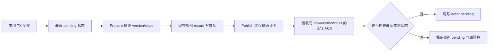

# BFP 分类协商 Stage B 实现：r9-next6

日期：2026-10-09。源码边界：`v0.1-r9-next6`，实验 `wireVersion=3`。

**Stage B 的核心机制已实现，冻结本地门槛已通过；Stage B 的完整验收仍未完成。** 本文记录实际源码行为和已经落盘的证据，不将 next5 的 Wire2 测试移作 next6 的 Wire3 验收，也不将某一次传输测试通过解释为稳定的恢复时限保证。

```text
acceptance_complete=false
production_ready=false
released=false
```

本文对应源码目录为 [r9-next6](C:/Users/developer/Desktop/bfp/.staging/r9-next6)。设计前置条件见 [分类协商 Stage B 实现门槛](C:/Users/developer/Desktop/bfp/docs/分类协商StageB实现门槛.md)。后者记录 next5 上的缺口和实施要求；本文记录 next6 的实际实现，不改写冻结 next5 的合同。

## 1. 冻结源码与证据边界

正式本地门槛冻结了 98 个 Go/module 文件，源码清单 SHA-256 为：

```text
055490ea2724f05796e24d2654236dcb6bdb4126e64125535d50c86865d3ce8e
```

清单见 [source-manifest.json](C:/Users/developer/Desktop/bfp/.staging/r9-next6/verification/r9-next6/local-gate/source-manifest.json)，本地结论见 [local-summary.json](C:/Users/developer/Desktop/bfp/.staging/r9-next6/verification/r9-next6/local-gate/local-summary.json)。该 summary 的 `local_checks_pass=true`、`source_unchanged=true`，整体 `pass=false`。整体状态保留完整验收尚未结束的含义。

| 检查或运行 | 已落盘结果 | 结论适用范围 |
|---|---|---|
| 首轮完整 Go test | `TestRunningUDPBlackholeRecoversSameExitAndBytes` 在原 8 秒 deadline 内失败 | 保留原始失败和当时诊断，不由后续通过覆盖 |
| 冻结正式本地 Go test | `go test -json -p 1 ./... -count=1 -timeout=180s`，16 packages、320 个顶层测试通过；Windows symlink 测试 1 个跳过 | 当前冻结源码的一次完整本地运行；`-timeout=180s` 是测试进程上限，未放宽该集成测试原 8 秒操作期限 |
| Go vet | 通过 | 当前冻结源码静态检查 |
| Windows / Linux 构建 | 两者通过 | 能构建当前源码，不代表远程运行或完整协议验收 |
| 独立 Linux race | 通过，run `ebcdaa28d0124d98287af8fb3047e6fc`，16 packages，exit 0 | 本次 run 的 98 个源码文件与冻结清单逐文件一致；owned cleanup 完成，receiver 前后快照未改变 |
| 新加坡→洛杉矶 Wire3 基础传输 / Ticket WAN | 未运行 | UDP 优先、初始失败、运行中失败须绑定 next6 二进制与新的 run ID；next5 的通过不覆盖 wire3 |
| 新加坡→洛杉矶 Wire3 分类专项 WAN | run `eba92b0b60d6cec0295ad61561a24778` 在准备/二进制上传阶段 `EOFError`，0 个业务场景 | 原始 `pass=false` 保留；后续仅恢复清理，两端目录移除且前后快照一致，不能声称分类业务或恢复收敛通过 |
| 第二次分类 WAN 准备 | `fb8fc723d30ce3e3966020d2e41d129e` 的发送机上传在原 180 秒超时，0 个业务场景 | 原始 FAIL 保留，两端 owned cleanup 与 baseline 比较通过 |
| 分类专项 WAN 三场 | `387c7e9fd1f9ff07c43cc1ead2ca355a`：normal 47/50、`tcp_exchange` FAIL；UDP→TCP 50/50、`idle_restore` FAIL；initial UDP blocked 转 TCP 50/50、CLI PASS | 固定 35 秒绝对期限与单操作 8 秒上限均未改变；最后一场 CLI PASS 不代表完整服务端证据、缺失 ACK 或耗尽门槛通过 |
| 该 run 的采集与清理 | 原采集进程被 owner-check 后停止；有界 RPC 取回原日志，只启动此前未运行的另两场；两端 owned cleanup 完成 | 本次 before 快照未落盘，`missing_current_baseline=true`，不能宣称系统前后不变；整体仍 FAIL |

独立 Linux race 使用 `go test -race -p 1 ./... -count=1 -timeout=180s`。原始结果见 [race-result.json](C:/Users/developer/Desktop/bfp/.staging/r9-next6/lab/runs/ebcdaa28d0124d98287af8fb3047e6fc/race-result.json)，日志见 [race-log.json](C:/Users/developer/Desktop/bfp/.staging/r9-next6/lab/runs/ebcdaa28d0124d98287af8fb3047e6fc/race-log.json)。这份通过覆盖 next6 的当前源码，不提供未执行 WAN 场景的结论。

正式构建产物仍是实验二进制：

| 平台 | 文件 | SHA-256 |
|---|---|---|
| Windows | [bfp-r9-next6-windows.exe](C:/Users/developer/Desktop/bfp/.staging/r9-next6/bfp-r9-next6-windows.exe) | `8f772287553dabe15cd9e7eca0c10c6330051ea0ba935f12962dfd4458349331` |
| Linux amd64 | [bfp-r9-next6-linux-amd64](C:/Users/developer/Desktop/bfp/.staging/r9-next6/bfp-r9-next6-linux-amd64) | `2583677700803cbabbbdf986454844a38fcd1512ba1e9a15e780c14e4de5df86` |

## 2. Wire3 的认证 profile / capability 协商

[bootstrap.go](C:/Users/developer/Desktop/bfp/.staging/r9-next6/session/bootstrap.go:20) 将实验 wire 提升为 3，Noise prologue 固定为：

```text
bfp/v3-class-announcement1/<mode>/<kind>/<attempt>/<generation>
```

初次与恢复握手都使用该合同。Wire2 的 bootstrap 版本和旧 Noise prologue 均拒绝混用。新能力没有在 Wire2 的 kind 14 上静默启用。

[capability.go](C:/Users/developer/Desktop/bfp/.staging/r9-next6/session/capability.go:13) 定义固定 profile `class-announcement-v1` 和 bit 0 的 `CapabilityClassAnnouncementV1`。`ClientConfig.Negotiation`、`ServerConfig.Negotiation` 为 Go API 的显式配置；nil 使用必需 profile 和 capability 1，显式零配置无效。构造器校验并复制配置，后续调用方修改原指针不改变已构造配置。当前 CLI 使用固定默认选择。

协商过程为：

1. 客户端将 `{p: profile, o: offered, r: required}` 放入 Noise 首个 payload，offer 上限为 256 字节。服务端消费 `ReadMessage` 的 payload，在既有设备/恢复授权后验证并选择能力。
2. 服务端选取客户端 offer、服务端支持集与已知能力的交集，要求覆盖双方 required。当前 profile 必须包含分类公告 v1；未知 required bit、required 不属于 offered、profile 错误、缺失/null/重复字段和额外字段均失败。未知的可选 offered bit 不会被选择。
3. 服务端在 Noise 加密的 `sessionInfo` 中返回 `p` 和 `z`（selected capabilities）。客户端验证选择来自自身 offer、覆盖 required、使用固定 profile，拒绝字段别名和未识别键。
4. challenge 确认继续检查 Noise `ChannelBinding`。offer 与 selection 都在 Noise transcript 内，修改它们不能产生同一确认绑定。
5. Session 保留选择。恢复客户端的 offered 与 required 均取原 selected；服务端要求 profile、offer、required、selection 与原 Session 一致。同 attempt 的并发候选也必须使用同一 offer 和选择。

因此换 UDP/TCP 承载不会重新解释分类语义，也不能改变一个已建立 Session 的能力集合。服务端仍沿用准入认证、UDP 首包 1200 B 和确认前反放大门槛；未通过认证或协商的 UDP 候选不发送错误说明。

`classTable=nil` 的 capability-zero 路径仅供旧的合成 transport fixture 使用。真实 Wire3 握手要求该能力，它不是公开的运行时降级入口。

## 3. 本地 TX 版本与首次公告时机

新增 [internal/classcontrol/table.go](C:/Users/developer/Desktop/bfp/.staging/r9-next6/internal/classcontrol/table.go:1) 作为纯状态模块；Session actor 串行调用它，模块没有 I/O、goroutine 或自行读取时钟。它不复用要求信用/偏移 Value 单调的 `latestcontrol` 表：类别值允许从 Bulk 2 降为 Normal 1 或 Interactive 0，单调的是 version。

每条已注册 flow 的本地 TX 状态从 `version=1` 开始。分类器 Observe/Tick 返回实际 `Changed` 时才增加版本，类别不变的查询、Tick、重发、padding 和承载替换不增加版本。达到 `MaxUint64` 后返回版本耗尽错误，由 Session 明确 reset flow，不回绕。公告与 ACK 不进入唯一业务字节累计。

`Start` 创建 gated pending 状态。客户端在成功安装 OpenResult 后 `Enable`；服务端在成功 OpenResult 的安装 receipt 完成后 `Enable`。发送门打开之前的本地类别变化仍产生版本并合并成最新状态，固定 pending 时限从首次 Enable 开始。OPEN 失败和终止 flow 释放 class 表项。

这一门槛只约束公告何时可以发出。本地调度继续由各端自己的 classifier 决定，分类 ACK 不是新建业务流的额外条件。

## 4. ClassUpdate 的线上合同

公告和 ACK 均为已认证加密 record 内的 `ClassUpdate`，kind 14：

| 字段 | TX announcement | 精确 ACK |
|---|---|---|
| Kind | `ClassUpdate`（14） | `ClassUpdate`（14） |
| Flags | `0` | `1` |
| Flow | 已建立 flow 的 ID，非零 | 同一 flow |
| Offset | 本端 TX version，非零 | 被确认的 version |
| Value | TX class 的完整 u64，范围 0–2 | 同版本的同一 class |
| Data | 空 | 空 |

[class_control.go](C:/Users/developer/Desktop/bfp/.staging/r9-next6/session/class_control.go:177) 在转换为 `protocol.Class` 前检查完整 Value，避免 `256` 被截断成 Interactive。非法 Flags、零 version、非空 Data、越界 class 等经认证的协议错误取消 Session；合法但未知、opening、失败或 terminal flow 的分类帧不安装 peer 状态，也不创建 flow 或目标连接。

## 5. 只有成功发布的精确状态才可被 ACK

公告采用 `Prepare → 完整承载写入 → Publish`。Prepare 产生绑定当前表项、版本、类别和 mutation 的不透明 token。排队、通过发送前检查或加密成功都不是 Publish；TCP 部分写失败、UDP 写失败和 pacer/cwnd 拒绝不会创建发布证明。actor 在完整写成功后提交，期间不会有 ACK 插入该提交。



状态表最多留存 16 份不同已发布版本的精确 class 证明。当前或历史保留范围内的 ACK 必须匹配完整 `(flow, version, class)`；未来版本、未发布的版本洞和同版异类返回错误。已淘汰历史范围内的旧 ACK 只被忽略，不据此宣称安装完成。

较旧但有发布证明的 ACK 可以推进已确认诊断，不能清除较新的 pending，也不能刷新其时限或重试预算。只有最新本地状态的精确 ACK 才完成该 pending episode。

接收公告完成 merge 后，单独的 ACK slot 保存实际输入状态。快照中看到较新 peer 版本后再收到旧公告，ACK 仍针对收到的旧公告；不会用快照里的较新版本制造对端尚未发布的未来 ACK。多个待响应公告合并到最高实际收到的版本。ACK 完整写成功才清除对应 slot，旧的成功写不能清除已被较新输入替换的 slot。ACK 没有独立重试定时器；重复公告会重新排入精确 ACK。

## 6. PeerTX 是只读的对端发送视图

公告和恢复快照共用 `MergePeer`，规则如下：

| 输入与已知 peer 状态的关系 | 处理 |
|---|---|
| 当前未知，或输入版本更高 | 安装新 PeerTX |
| 同版本、同类别 | 幂等重复 |
| 输入版本更低 | 忽略，不回退 |
| 同版本、不同类别 | 冲突，Session 拒绝继续 |

版本跳跃合法，不要求收到每个中间版本。`MergePeer` 只查询本地已经注册的 flow，没有接收输入分配状态的路径。

[classification.go](C:/Users/developer/Desktop/bfp/.staging/r9-next6/session/classification.go:17) 的 owner 快照公开 `LocalTX`、`TXVersion`、`TXPublishedVersion`、`TXAckedVersion`、`TXPending` 和 `PeerTX{Known, Version, Class}`。Interactive=0 是有效类别，只有 Known 标识能区分未知对端状态。查询不 Tick、不修改分类器，也不累计控制流量。

对端公告 Interactive 仅改变它自己的 TX 观察视图，不改变本端 classifier、baseline、effectiveClass、策略上限、信用、目标 ACL、目标连接、唯一业务累计或可靠性合同，不触发反方向类别变更。TCP 仍提供原字节流/FIN/RESET 语义，UDP Datagram 仍遵守原 best-effort 语义。分类协商不能凭对端类别改写这些合同。

## 7. 独立选择控制项，仍共享有限发送预算

分类控制由有界 class 表直接选择，避免排在同 flow 已有的 Bulk FIFO 后。实现没有伪造可能与业务流碰撞的保留 flow ID。

TCP 与 UDP 的一次正常 flush 仍最多选择 4 个发送项。`nextSendFrame` 仅在前 2 个 slot 尝试分类控制；TX announcement 与 ACK 轮换，各自以 flow ID round robin 选择。没有 ready 分类项时回到原队列，后 2 个 slot 使用原队列。因此分类增加的是现有 4 个 slot 内的有限份额，而非独立追加无限优先机会。这个上限不构成固定发送延迟或长期 fairness 保证。

UDP 公告和分类 ACK 走普通 `udpSend`：支付编码、随机 padding 与 record overhead 的实际成本，检查 ledger admission、pacer token 和 cwnd，并记入 flight。分类 ACK 不借用 PacketAck 专用反馈 token，不使用 PTO probe 的有限负 token 例外。TCP 完整写入后启动逻辑公告重试间隔，不通过补发业务数据模拟分类确认。

UDP loss/PTO 的 ClassUpdate logical ref 只使当前最新 pending 状态重新 eligible，不重发 ref 中的过期类别。ACK ref 不生成独立分类重试。每 flow 最多一份最新 pending announcement 和一份待发送 ACK；表项最多 4096，精确发布历史也固定有界。

## 8. 固定 pending 时限与耗尽策略

默认 class-control 配置为 `MaxRetries=8`、`NoProgress=30s`。首次成功公告写入不算 retry，此后同一个 pending episode 中的每次成功写入都消耗一次 retry，包括发送替代版本和换承载后立即重发。因此最多是首次发布加 8 次实际 retry；发送前拒绝和写失败不消耗成功发布次数。

重试 base 被夹在 200 ms–2 s，随已消耗 retry 指数退避，单次间隔最多 8 s。模块同时检查固定 30 秒绝对 pending 时限。时限从 Enable 或上一次最新状态精确 ACK 后新建 pending episode 开始；旧 ACK、版本更新、普通业务、查询、loss ref、suspension 和 RebindCarrier 均不续期。

耗尽时 Session 通过已有有界 RESET/终止记录路径结束该 flow，错误为 `ErrClassControl`，释放 class 状态并清理对应业务资源。此策略可能让长期缺失分类 ACK 的业务 flow 结束；它不无限重发，也不会 redial 来重建该 flow。正常 FIN 终止、OPEN 失败和显式 RESET 同样释放状态，随后合法迟到分类流量不复活该 ID。class-control 的 30 秒预算与现有 UDP path watchdog 是不同机制。

## 9. 恢复快照与 ResumeDone 的边界

Wire3 的 `flowSnapshot` 新增可选嵌套 `tc:{v:version,c:class}`。对象存在性与数值分别校验，缺失、null、重复字段、额外字段和非法完整 class 值不能默认为 Interactive。能力启用时，普通有效快照必须有 tc；reset 或 failed/limit 快照可以没有 tc。

快照携带生成快照一端自己的 TX 状态。对端应用时调用相同 `MergePeer`，不覆盖本地 TX、不重建本地 classifier、不产生 ClassUpdate ACK、不完成本地发布证明。快照 receipt 仍在现有恢复字段成功应用后发送。

attach 保留 classifier、累计唯一业务字节、本地 TX version、发布/确认历史、peer-view、pending 起点和 retry；`RebindCarrier` 仅使尚 pending 的本地状态可在新承载上重发，并使旧承载的预备 token 失效。

分类发送门要求 `peerDone && localDoneAck`。既有 `syncAllowed` 在恢复完成前只允许 ResumeState、ResumeDone、Ping、Pong、PacketAck；分类公告和 ACK 等待恢复 barrier 完成。生成固定快照后发生的本地类别变化保留为最新 pending，恢复后重新选择它。类别不进入 dirty-credit 列表，分类 ACK 不成为新的业务开放 barrier。

当前本地恢复测试证明 actor 级别的快照 merge、receipt 不冒充精确分类 ACK、原预算保留和恢复门后选择最新状态。该测试包含真实 UDP publication，但通过 seam 操作恢复门与 transport scope；它本身没有完成真实 UDP→TCP attach 后的端到端分类收敛。已有传输恢复测试与这个分类恢复测试的结果需要分别解释。

后续 [next7 分类恢复丢帧验证](C:/Users/developer/Desktop/bfp/docs/分类恢复丢帧验证-r9-next7.md) 只新增一个测试文件，补充真实 NewClient 初始回退、真实 UDP watchdog→Client.recover→TCP、快照冻结后的 v2→v3 变化和双向公告/ACK 丢失场景。它保留 classifier/Flow/目标指针、原 pending 起点与预算，目标只 dial 一次。自然定时器与显式 loss signal 分开命名，不能把后者的 2 秒窗口写成自然恢复保证。next7 的完整 Windows gate 仍因另一旧测试的 UDP 端口 setup 碰撞失败，新增选定场景通过不能改写该 gate。

## 10. 已实现的测试与诊断工具

| 类别 | 当前冻结源码覆盖 | 证据路径 |
|---|---|---|
| 握手 | 真实初次/恢复协商、v2 拒绝、offer/selection 非法字段、first payload 篡改、confirm transcript 绑定、同 attempt 变更拒绝、恢复增添/降级拒绝、UDP 拒绝候选静默 | [capability_test.go](C:/Users/developer/Desktop/bfp/.staging/r9-next6/session/capability_test.go) |
| 纯状态表 | 初始版本、类值降低、准确发布、旧 ACK、新版替代、8 次 retry 与 30 秒时限、rebind 不续期、16 份历史边界、peer merge、ACK slot、版本不回绕、未知 flow 不分配 | [table_test.go](C:/Users/developer/Desktop/bfp/.staging/r9-next6/internal/classcontrol/table_test.go) |
| 真实加密 TCP/UDP 分类帧 | 双向初始公告、OPEN 前不安装、peer-view 只读和单调、非法经认证输入、未知/RESET/FIN 终止 flow 不分配、丢 ACK 后重发精确 receipt、旧 ACK 不清新版、未来/未发布/异类 ACK 拒绝 | [class_announcement_runtime_test.go](C:/Users/developer/Desktop/bfp/.staging/r9-next6/session/class_announcement_runtime_test.go) |
| Session 发送预算与恢复 seam | TCP 部分写失败、UDP admission/写失败、恢复门、Bulk FIFO 旁路与 4 slot 上限、loss 选择最新状态、ACK 无独立重试、耗尽 RESET、快照不确认本地发布 | [class_control_budget_test.go](C:/Users/developer/Desktop/bfp/.staging/r9-next6/session/class_control_budget_test.go) |
| 快照 schema | 明确存在性、严格 JSON 字段、完整宽度 class 校验 | [class_snapshot_test.go](C:/Users/developer/Desktop/bfp/.staging/r9-next6/session/class_snapshot_test.go) |
| 分类实验 CLI | 加密 UDP/TCP 上 Normal→Bulk→Normal，版本推进、local exact ACK、Known peer、唯一业务字节及失败产物保留 | [class_probe_test.go](C:/Users/developer/Desktop/bfp/.staging/r9-next6/cmd/bfp/class_probe_test.go)、[next6-class-probe.log](C:/Users/developer/Desktop/bfp/.staging/r9-next6/verification/r9-next6/next6-class-probe.log) |

新增 `class-probe` 是有界实验命令，单次 TCP echo 操作继续使用既有 8 秒期限，外层实验绝对期限只能缩短它。结果分为 `checked_gates` 与 `unchecked_gates`；它自行检查客户端 owner 的精确发布/确认和只读 peer 公告，未自行证明服务端精确发布/确认、服务端唯一字节、目标连接数、缺失 ACK 注入、耗尽或完整 carrier matrix。这些 `unchecked_gates` 保持 false，不能用命令自身的 pass 填成完整专项验收通过。

服务端 `-class-stats` 可输出有限、只读的各 Session/flow 分类快照，供外部 runner 对比双端状态；查询不公开目标地址、认证材料或完整库存。它提供观察证据，不替代对目标连接保持和恢复边界的独立检查。

首轮分类运行时只读视图测试也保留了一次失败：测试过早取样，普通应用 consumption 导致的信用更新尚未到达对端，之后才看到 `maxRemote` 与 Session credit 增长。后续测试等到具体预期信用值并冻结 classifier 时钟；该修正没有改生产代码或延长 deadline。原始摘录见 [class-runtime-initial-failure.log](C:/Users/developer/Desktop/bfp/.staging/r9-next6/verification/r9-next6/class-runtime-initial-failure.log)。

分类专项 WAN run [eba92b0b60d6cec0295ad61561a24778](C:/Users/developer/Desktop/bfp/.staging/r9-next6/lab/runs/eba92b0b60d6cec0295ad61561a24778/class-wan-result.json) 在二进制上传准备阶段连接中断，错误类型 `EOFError`，尚无配置或业务进程，0 个业务场景。原始报告也保留当时 cleanup 的 SSH 错误与 `selected_checks_pass=false`。后续只读管理预检查成功后，使用原 run ID/owner 标记恢复清理：[setup-cleanup-recovery.json](C:/Users/developer/Desktop/bfp/.staging/r9-next6/lab/runs/eba92b0b60d6cec0295ad61561a24778/setup-cleanup-recovery.json) 确认两端目录移除，process/container 列表为空，服务/路由/防火墙前后快照一致。没有重跑或延长业务期限，没有把清理恢复写成专项通过。

阶段索引见 [evidence-index.json](C:/Users/developer/Desktop/bfp/.staging/r9-next6/verification/r9-next6/evidence-index.json)。该索引分开保留本地/race PASS、首轮 8 秒恢复失败、WAN 准备失败、清理恢复和未运行项目，整体 `selected_checks_pass=false` / `pass=false`。

## 10.1 后续有界上传与同一 run 的恢复采集

第二次准备 run [fb8fc723d30ce3e3966020d2e41d129e](C:/Users/developer/Desktop/bfp/.staging/r9-next6/lab/runs/fb8fc723d30ce3e3966020d2e41d129e/class-wan-result.json) 使用同步 32KiB 压缩上传。接收机完成，发送机在固定 180 秒内只确认 3,702,784/4,039,960 字节；没有业务场景，两端 owned cleanup 和本次 baseline 比较通过。

run [387c7e9fd1f9ff07c43cc1ead2ca355a](C:/Users/developer/Desktop/bfp/.staging/r9-next6/lab/runs/387c7e9fd1f9ff07c43cc1ead2ca355a/class-wan-result.json) 冻结的 helper 是 **v2**：确定性 gzip、最多 3 次管理连接、32KiB chunk、每批最多 4 个未完成写入、原 180 秒总上传/提交期限、恢复前核对前缀长度/hash、独占 ELF 提交和完整 SHA256 证明。接收机 20.778 秒、发送机 115.719 秒各一次上传成功。后来 v2.1 增加提交前后的原 deadline 检查；本次实际上传均在期限内，但不能把冻结 v2 helper 改名为 v2.1。

原 normal 场景 35 秒终止，完成 47/50 次 4096B TCP echo，`failure=tcp_exchange`；UDP 保持 generation 1，初始分类和 Bulk 已被观察。随后主 runner 卡在采集阶段，已记录 owner 校验与本地中断。独立恢复程序没有重跑 normal，而是以本次 owner 标记和原配置，只启动尚未运行的 UDP→TCP 与 initial UDP blocked 各一次。UDP→TCP 完成 50/50，但 idle 分类恢复/精确确认在 35 秒内未完成；initial UDP blocked 转 TCP 的 CLI 检查通过。服务端、目标计数和客户端关闭前最终视图由独立审计解释，不能单凭 CLI 的 pass 推导整个 Stage B 完成。

恢复采集采用有界 RPC gzip/base64 快照，server.log 为 2,566,534 字节，未超过原 4MiB cap；probe/fixture log 使用原 1MiB cap，明确校验长度和 hash。两端 owned 进程和目录已删除。原 runner 将 before 快照留在内存，没有落盘，故本次 `missing_current_baseline=true`；保存的 after 快照不能提供本次前后不变证明。三场结果、原采集中断和缺失证据均保留，整体 `pass=false`。

用户明确新加坡网速较慢。后续管理传输继续压缩、有界并发，业务场景逐个执行；必须区分链路容量、RTT、实验采样合同和协议错误。当前证据没有证明 normal 总期限失败或 idle_restore 失败的唯一根因，不放宽原 deadline，不循环重跑 unchanged 场景筛选成功。

独立 [class-wan-independent-audit.json](C:/Users/developer/Desktop/bfp/.staging/r9-next6/lab/runs/387c7e9fd1f9ff07c43cc1ead2ca355a/class-wan-independent-audit.json) 已完成源码/ELF 绑定与 9,853 行服务端日志完整性核对。initial UDP blocked 的 initial/Bulk/restored/final 四检查点均存在双向精确 ACK，最终 TCP/generation 1 的双方唯一业务字节均为 204800；normal 与 UDP→TCP 的完整四检查点不通过，整体仍 false。失败分析见 [failure-analysis.json](C:/Users/developer/Desktop/bfp/.staging/r9-next6/lab/runs/387c7e9fd1f9ff07c43cc1ead2ca355a/failure-analysis.json)。normal 的最后成功 iteration 46 已至 flow elapsed 34290.8ms；UDP→TCP 最后业务采样至 33860.5ms，服务端同 TCP/generation 2 独立确认 204800 字节，到 34761ms 仍为 Bulk v2/pub2/ACK2、WindowBytes=0。剩余时间需与统计窗口过期、600ms 低速持续期及 1000ms 固定证据等待一起解释，不能把没有剩余观察时间直接写成分类状态机故障，也不能把整个场景改判 PASS。

审计保留首版解析结果 `class-wan-independent-audit-v1.json`，修订版明确区分合法的空 flow `null` 视图、失败 CLI 唯一预期尾行与非法 JSON。冻结 CLI 的外层 defer 在关闭 Flow 后重采 Stats，所以 `result.Final.flows=0`；审计仅使用与最终类别完全匹配、同 Session/Flow/carrier/generation 的关闭前 final progress 来证明 live flow，原 result 不变。后续 next7 独立 Linux race run `8143bae4f4ba07196d51f1e2652e6172` 为 16 包 PASS，99 文件与冻结清单匹配，owned container/目录清理及洛杉矶前后快照比较通过；它不覆盖缺失的 WAN 门槛，也不改写 next7 的 Windows gate 失败。

## 11. 保留的 8 秒黑洞失败与未完成验收

首轮完整 Go test 中 `TestRunningUDPBlackholeRecoversSameExitAndBytes` 在 8.04 秒失败，报告 `context deadline exceeded`。原始记录见 [initial-full-go-test.jsonl](C:/Users/developer/Desktop/bfp/.staging/r9-next6/verification/r9-next6/initial-full-go-test.jsonl:2081)。其当时采样为：

```text
carrier=udp                 generation=1
switches=0                  udp_path_present=true
udp_suspect=false           udp_no_response_deadlines=2
udp_pto_rounds=3             udp_base_pto_ms=625
udp_deadline_remaining_ms=1397
udp_no_progress_age_ms=7982
tcp_recovery_attempts=0     tcp_recovery_failures=0
tcp_recovery_in_flight=false
```

这些诊断证明当时已经发生 3 个 PTO round，但连续无响应 deadline 只有 2 次，尚未进入 suspect，也没有发起 TCP recovery。它不支持“3 个 PTO 必定切换”的解释。默认 15 秒 UDP watchdog 与该测试原 8 秒期限均未因 Stage B 放宽。

冻结正式本地运行中，同名测试在 1.77 秒通过，见 [go_test.log](C:/Users/developer/Desktop/bfp/.staging/r9-next6/verification/r9-next6/local-gate/go_test.log:2585)。这是一条独立运行结果，不消除前一次失败，不证明 watchdog 已修复，也不提供所有路径都能在原期限内恢复的稳定保证。

Stage B 完整验收仍需要新加坡 `198.51.100.20` 发送、洛杉矶 `192.0.2.10` 接收/出口的 Wire3 运行证据。分类专项应核对双端初始公告、Bulk 降级与恢复、缺失 ACK 后的实际有限重试、UDP→TCP 后最新版本收敛、同 Session/flow 和同目标连接，以及服务端唯一业务字节。每次结果必须绑定当前 manifest、二进制 hash、冻结配置和 run ID，并保留失败，不能靠延长既定 deadline 或反复重跑筛选通过结果。

当前实现没有使 TUN/fake-IP/IPv6/DNS、原生 Mihomo/sing-box outbound、混合类别长期 fairness/goodput/p95/p99 或独立安全评审自动达标。Stage B 机制落地、本地选定门槛通过和整个协议可生产交付是不同结论；本文维持 `acceptance_complete=false`、`production_ready=false`、`released=false`，没有 release ZIP。
