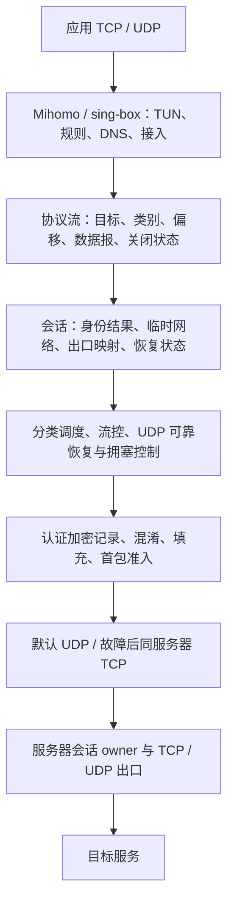
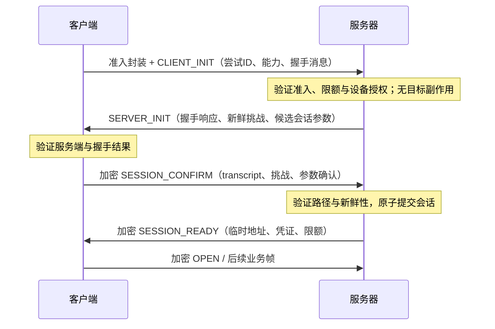
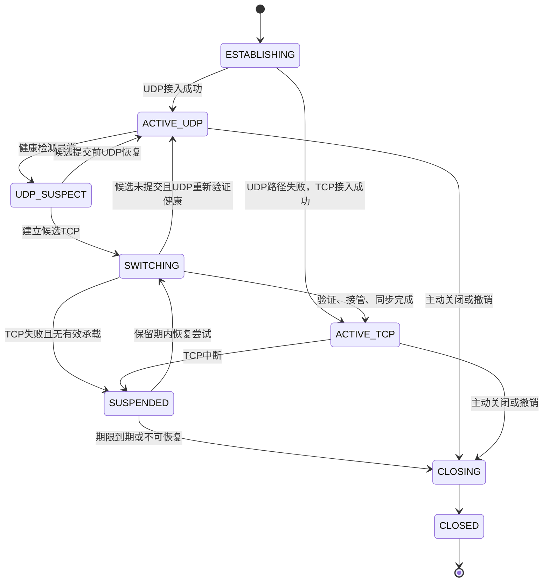

# 新协议技术设计 v0.1

当前产品入口为 [根项目说明](../README.md) 和 [Mihomo 原生接入](Mihomo原生接入-v0.1.md)：独立协议包 preview.5、当前原生接入包 preview.12 已生成。本文保留各阶段设计和历史候选边界；相应时点的“未发布 ZIP”及未实现条目不能直接当作当前交付状态，当前运行证据以产品记录为准。

日期：2026-10-07  
状态：架构与协议语义草案；已有 Go v0.1 实验实现，尚未冻结互操作规范或经过独立安全审计  
适用场景：一台客户端设备直连一台固定出口服务器  
协议名称：待定；本文中的消息名称和工程目录名称用于描述设计

本文定义从零开始的独立代理协议。协议自行规定握手、会话、报文、流、调度、恢复与混淆机制，直接使用 UDP 或 TCP 承载。Mihomo/sing-box 提供接入、TUN 和规则能力。

文中的“必须”表示实现需要保持的不变量；“建议”表示本稿提出的初版方案；“候选值”表示需要通过实验校准的参数。本文保留目标架构，实际实现和差异以[实现进度](实现进度.md)、[实验 wire](wire-v0.1.md)和[验收记录](验收记录-v0.1-r3.md)为准。当前仅有同一 Go 实现的测试结果，尚无跨实现互操作证据。

## 1. 已确认需求

| 编号 | 要求 | 设计落点 |
|---|---|---|
| R1 | 独立的新协议，直接建立在 UDP/TCP 上 | 自有握手、线格式、状态机和传输机制 |
| R2 | 默认 UDP；UDP 失败后自动平滑切换到同服务器 TCP | 承载健康检测、候选 TCP、会话恢复和进度同步 |
| R3 | 一台设备直连一台固定出口服务器 | 两端会话网络，固定服务器端点与出口 |
| R4 | 一次会话认证供多条流复用，支持密钥更新与断线恢复 | 身份认证、会话凭证、独立恢复秘密、密钥 epoch |
| R5 | 协议内部按类别分流 | 元数据、行为分类、分级队列、发送调度 |
| R6 | 会话级短时局域网，结束时销毁所属资源 | 临时地址、流编号空间、出口映射和会话专属缓存 |
| R7 | 流量混淆 | 首包封装、字段隐藏、长度填充、受限发送整形 |
| R8 | 防止主动探测获得协议特征和未授权访问 | 首包准入、静默失败、防重放、抗放大和资源限额 |
| R9 | 接入 Mihomo/sing-box，由其 TUN 支持全局代理 | 独立客户端验证、后续原生 outbound 集成 |

“平滑切换”的要求是：在会话状态仍被保留、目标连接仍存活、资源预算未耗尽的条件下，应用连接继续存在，业务允许短暂等待，恢复后继续传输。该要求不包含网络永久中断、目标主动关闭或服务端进程重启后的无条件恢复。

## 2. 设计原则与初版范围

1. 会话拥有流和出口连接，承载只提供传输路径。
2. 新开流复用会话认证；所有记录仍进行加密完整性验证和防重放。
3. 初版每个会话只有一个提交后的有效业务承载；候选承载只能进行握手与恢复控制。
4. UDP/TCP 共享内部帧和流语义；外部记录封装、拥塞控制方式可以不同。
5. 可靠流按会话内的字节偏移恢复，承载包号仅处理本承载的接收与丢包。
6. 未完成身份授权和新鲜性确认前，不建立目标 socket，不交付业务数据。
7. 所有队列、重组、握手、流表、操作去重和关闭记录都有明确上限。
8. 混淆、填充、重传和纠错的成本必须进入带宽、拥塞和资源预算。

建议初版交付独立客户端/服务器、可靠字节流、固定目标 UDP 数据报、UDP→TCP 回退、会话恢复、三类调度、轻量混淆、防探测准入和 SOCKS5 接入验证。原生 Mihomo/sing-box 集成作为后续明确开发阶段。

多设备 mesh、二层桥接、ARP/NDP、广播发现、多路径聚合和多出口不属于本稿初版范围。FEC 和自动 TCP→UDP 回切保留扩展位置，首个 PoC 可关闭。首版切换到 TCP 后建议保持 TCP 到会话结束，以控制路径抖动和实现复杂度；这是设计建议，尚非已确认要求。

## 3. 分层架构与核心对象



| 对象 | 保存的状态 | 生命周期与归属 |
|---|---|---|
| Service | 服务端身份、设备授权、准入配置、全局限额 | 长期部署配置 |
| Session | 随机会话 ID、身份结果、临时地址、流表、凭证、恢复秘密、保留期限 | 首次握手创建；结束时销毁 |
| Carrier | UDP 路径或 TCP 连接、绑定代次、记录密钥、包号、路径健康 | 隶属会话；可被替换 |
| Flow | 目标、交付语义、类别、双向偏移、窗口、FIN/RESET、出口 socket | 隶属会话；不随承载替换而重新创建 |
| Operation | 建立会话、OPEN、绑定等操作的编号与结果 | 有界幂等记录 |
| Ephemeral Network | 两端临时逻辑地址、流编号空间、目标映射、会话专属 DNS 结果 | 与 Session 同寿命 |

必须区分三个序号：

- `carrier_generation`：承载接管代次，阻止旧候选覆盖新承载。
- `key_epoch`：该承载内的密钥阶段，管理更新和旧密钥保留。
- `record_no`：该方向、该密钥阶段下的记录号，用于 nonce 和防重放。

跨承载的可靠数据去重使用 `flow_id + direction + byte_offset`，不得使用 `record_no`。

### 3.1 会话 owner

建议每个 Session 使用一个串行 owner 管理状态提交。网络读取、DNS、目标拨号、目标读写可在独立任务执行，但只能向 owner 投递有界事件。

owner 必须统一提交承载替换、OPEN 登记、流关闭、偏移更新与资源销毁。异步结果携带 Session、Flow 和操作代次；已经过期的结果只能释放资源，不能重新激活流或出口映射。

## 4. 短时局域网与地址模型

“短时局域网”的协议术语定义为**会话级临时网络上下文**，成员为客户端和出口服务器。

每个 Session 建议分配随机 128-bit 会话 ID、两端临时逻辑地址和独立流编号空间。这些地址用于协议内部表达源、目的和角色，置于加密内容中。Mihomo/sing-box 的 TUN 地址属于适配层，两者不必相同，也不要求协议额外创建操作系统虚拟网卡。

客户端发起的 `flow_id` 建议采用单调递增 64-bit 编号，在同一 Session 内永久不复用。每条可靠流包含两个方向；每个方向具有独立字节偏移和 FIN 状态。初版允许客户端打开出口流，服务器通过同一流返回数据。

Session 拥有：临时地址、流表、目标 socket、UDP association、目标绑定、DNS 查询结果、发送与重组缓冲、定时器、工作任务、密钥、恢复凭证和关闭记录。

### 4.1 销毁流程

1. owner 将会话转为 `CLOSING`，拒绝新 OPEN 和新承载提交。
2. 失效恢复资格，停止所属定时器和待完成查询/拨号。
3. 根据关闭原因执行有界排空或中止所有流。
4. 关闭所属 TCP/UDP 出口 socket 和承载，回收队列与重组状态。
5. 等待工作任务退出，清除会话专属缓存和秘密引用。
6. 记录不含秘密的终止统计，转为 `CLOSED`。

销毁必须可重复调用，实际释放仅执行一次。新会话不能接受旧会话记录、旧恢复请求或旧异步回调。

清理范围是协议持有的会话资源。系统 TUN、共享 DNS 缓存、长期设备凭据、固定公网地址和按策略保存的日志各有独立生命周期。实现还需说明所用语言对秘密内存清除的实际能力，不能只因删除对象引用就宣称所有内存已擦除。

## 5. 身份、握手与密钥管理

### 5.1 威胁与信任前提

设计覆盖被动流量观察、未授权端口探测、伪造/篡改/重放、恢复请求竞争，以及恶意输入造成的计算和内存消耗。已控制客户端或服务器、已窃取全部身份秘密的攻击者超出正常保密假设，需要凭据撤销和部署隔离处理。

客户端必须验证预配置的服务端身份；服务器必须验证设备授权。建议采用维护中的 Noise 实现，首次握手候选为 `Noise_IK_25519_ChaChaPoly_SHA256`：客户端固定服务端公钥，服务器授权设备静态公钥。该选择是设计建议，密码库、合法密钥导出接口、恢复 pattern 和测试向量尚待确认。

自有协议定义消息、状态和绑定语义，密码运算使用成熟实现。Noise 本身不提供本文全部混淆和准入要求。

### 5.2 首次接入



未完成 `SESSION_CONFIRM` 前，仅保留有界握手状态；禁止 OPEN、目标 DNS/拨号和业务写入。初版禁止有出口副作用的 0-RTT 数据。

`connect_attempt_id` 建议为随机 128-bit 值。同一连接尝试跨 UDP/TCP 使用同一编号，服务器在完成设备认证后以“设备身份 + 尝试编号”协调候选，防止 UDP 迟到成功与 TCP 重试创建两个活动会话。重试必须遵守所选握手库的消息重传规则，不能重新使用同一密钥与 nonce 加密不同内容。

如果 UDP 握手只因超时或路径问题失败，可通过 TCP 执行同等认证。明确的服务端身份错误、设备拒绝和权限错误按安全错误终止，不通过更换承载降低要求。

### 5.3 会话凭证与快速恢复

首次会话建立后生成：

- 不透明 `resume_ticket`：定位并约束恢复资格，绑定会话、设备、服务端实例和有效期。
- 独立 `resume_secret`：用于持有者证明，置于加密交换或由握手秘密按正式接口派生。

Ticket 字节本身不能授权接管。恢复必须证明持有 `resume_secret`，并绑定新握手 transcript、服务端新鲜挑战、会话 ID、候选承载、尝试编号和预期代次。

恢复建议使用带 PSK 且含新临时密钥交换的成熟握手 pattern；具体 pattern 在密码方案冻结时确定。恢复复用原会话授权和流状态，避免重新注册与重建网络；新承载仍须完成必要的密码验证和新密钥建立。

Ticket 有效期、无承载保留期限、健康会话寿命分别管理。健康活动会话不应仅因某份 Ticket 到期而关闭；可在活动承载中刷新 Ticket。会话撤销、关闭或服务端实例失效必须使相关恢复资格失效。

初版只恢复内存中仍存活的 Session。服务端重启后，旧票据不能导致重新拨号目标并冒充原连接。

### 5.4 密钥作用域与更新

必须对准入、握手、恢复证明、记录内容、记录头部保护和 TCP 长度保护进行用途分离。流量密钥至少区分服务实例、Session、承载代次、方向和密钥 epoch。

`nonce` 只能由该密钥下唯一的记录号按冻结规范生成。记录号不得回退或溢出；承载切换需要新密钥，不能把旧密钥下的计数器直接清零。

UDP 重传逻辑内容时，使用新记录号重新封装。握手缓存密文的重发按握手规范处理。旧接收 epoch 仅在有界乱序窗口内保留，解密只尝试有限密钥集合；不能按未验证的任意 epoch 无限派生或搜索密钥。

密钥更新需定义提议、确认、开始使用和旧 epoch 退役。新 epoch 下继续保留流偏移与 Session。基于旧秘密的 KDF 更新不能自动宣称具有密钥泄露后的安全恢复能力。

握手 transcript/hash 用于绑定与校验，不能直接当作保密主密钥。实现必须验证所选库的正式密钥接口与生命周期。

## 6. 会话和承载状态机

| 状态 | 新开流 | 已有流 | 允许的操作 |
|---|---|---|---|
| `ESTABLISHING` | 禁止 | 无 | 准入、握手、确认 |
| `ACTIVE_UDP` | 允许 | 正常 | UDP 数据和控制；密钥更新 |
| `UDP_SUSPECT` | 建议暂缓 | 保留、背压 | 健康探测；建立候选 TCP |
| `SWITCHING` | 有界等待 | 保留、同步 | 验证候选、绑定、恢复同步 |
| `ACTIVE_TCP` | 允许 | 继续原流 | TCP 数据和控制；密钥更新 |
| `SUSPENDED` | 禁止 | 保留至期限 | 有限恢复尝试 |
| `CLOSING` | 禁止 | 排空或中止 | 资源回收 |
| `CLOSED` | 禁止 | 全部结束 | 仅终止统计 |



状态表中的“有界等待”必须具有队列和截止时间，不能让新开流永久挂起。所有状态均可因明确的安全错误或管理撤销进入关闭流程。

### 6.1 UDP 故障判定

初始建连设有限重试和总期限。活动路径综合考虑经过认证的收包、RTT/波动、探测响应和本地明确路径错误。单次丢包不能直接判定 UDP 不可用。

建议通过基于 RTT 的 PTO 和连续多轮无认证响应进入 `UDP_SUSPECT`。已有正常认证响应时不因某一个 PING 丢失认定整条路径失败。空闲时低频健康探测受预算限制；故障计时使用本机 monotonic clock，不依赖两端 wall clock 相同。

持续低吞吐可另设退化策略，需要区分拥塞、应用空闲和路径限制；初版先支持可复现的路径故障回退，不把低速直接当成故障。

### 6.2 运行中 UDP→TCP 切换

1. 客户端停止向旧 UDP 承载提交新的业务；可靠流进入有界缓冲，入口施加背压。
2. 在总切换预算内连接同一服务器的 TCP 入口。
3. 完成准入及恢复握手，验证 Ticket 与持有者证明。
4. owner 校验预期代次，原子提交新的 `carrier_generation`，旧 UDP 失去业务提交资格。
5. 双方分批交换可靠流接收偏移、OPEN 结果、窗口与 FIN/RESET 状态。
6. 验证同步状态一致，从仍保留的字节补齐缺口，再继续新数据。
7. 进入 `ACTIVE_TCP`，退役旧承载并释放其路径资源。

候选在提交前不得执行 OPEN、交付新业务或接管目标写入。并发恢复只能有一个候选成功提交；迟到候选和旧代次不能覆盖新承载。

候选尚未提交且原 UDP 已重新验证健康时，owner 可取消候选、解除暂停并返回 `ACTIVE_UDP`。新代次一旦提交，旧 UDP 不得通过该返回路径重新取得业务资格。

初版建议在新代次提交后直接丢弃旧承载业务记录，依赖稳定流偏移从新承载补齐。提交前已经进入会话的旧数据由流偏移去重。以后若增加旧承载排空期，也只能接收验证后的迟到内容，不能授予第二个业务 owner。

切换结果确认丢失时，客户端使用同一 `attach_attempt_id` 和新的验证请求查询/继续原操作。服务器返回原操作结果，不能重复增加代次。具体确认与查询编码在恢复规范中冻结。

### 6.3 恢复失败

TCP 建连、准入、绑定和同步各有超时。两种承载都不可用时进入 `SUSPENDED`，保留期限内继续有界恢复。目标 socket 自然关闭时，对应流失败；不会为了恢复而重新拨号目标。

若会话不存在、已撤销、已过期或缓冲状态不可恢复，明确结束相应流或 Session。接入层可另行建立新会话，但旧流必须先报告失败，新会话使用全新临时网络。

## 7. 报文、记录与逻辑帧

### 7.1 外部封装

UDP 以一个数据报承载一个有界加密记录；建议初始最大 UDP payload 为 1200 B，包含协议头、加密 tag、帧和填充，不包含 IP/UDP 头。路径 MTU 较小时需要降低上限，禁止依赖 IP 分片承载超限记录。

TCP 是字节流，必须自行分帧。建议采用受保护长度前缀和有界加密记录；长度验证完成前不按攻击者声称的长度分配缓冲。内部业务长度、帧类型和版本协商置于加密范围内。

| 封装阶段 | 逻辑结构 | 线上与解析要求 |
|---|---|---|
| 首包准入 | 随机材料 + 有界认证封装 + 握手内容 + 可变填充 | 无明文协议 banner、固定 magic、设备 ID 或目标；详见第 11 节 |
| 活动 UDP | 不透明查找句柄 + 受保护记录头 + 加密帧和填充 + tag | 句柄用于有限查找；epoch/记录号参与认证和防重放 |
| 活动 TCP | 受保护长度 + 加密帧和填充 + tag | 顺序解析，双向记录号独立，有严格长度上限 |

不透明查找句柄建议使用随机 128-bit 值并允许受控轮换。句柄在同一阶段内仍可能关联包，不能将其称为不可关联。最多保留少量当前/过渡句柄，未知句柄不得造成无界密钥搜索。

UDP 头部保护的具体算法、TCP 长度保护方式、密钥派生标签、AAD、字节序和字段宽度必须另行冻结并形成测试向量。本稿不把未审查的头部混淆构造当作已确定密码方案。

### 7.2 通用帧

建议加密内容采用有界 TLV：帧类型、关键标记、长度、内容。帧长度不能超过剩余明文；每记录帧数、嵌套和可选字段数量受限。未知可选帧可跳过，未知关键帧只向已经认证的对端返回受保护错误。

以下名称表示逻辑帧，数值编号待定：

| 帧组 | 帧 | 主要字段与语义 |
|---|---|---|
| 会话 | `SESSION_CONFIRM` / `SESSION_READY` | transcript、新鲜挑战、能力、临时地址、会话限额 |
| 存活 | `PING` / `PONG` | 有界探测编号；只计认证成功的响应 |
| UDP 确认 | `PACKET_ACK` | acked_key_epoch、有界 ACK ranges、ACK delay；仅确认当前承载代次的反方向记录 |
| 开流 | `OPEN` | flow_id、操作 ID、目标、交付语义、元数据与类别提示 |
| 开流结果 | `OPEN_RESULT` | 原操作成功/失败、最终目标绑定、有效类别 |
| 可靠数据 | `STREAM_DATA` | flow_id、方向、byte_offset、data |
| 流确认 | `STREAM_ACK` | flow_id、方向、连续接收偏移 rx_next |
| 流控 | `MAX_FLOW_DATA` / `MAX_SESSION_DATA` | 单调增加的绝对信用上限 |
| 关闭 | `FIN` / `FIN_ACK` / `RESET` / `RESET_ACK` | flow_id、方向最终偏移或终止错误 |
| 数据报 | `DATAGRAM_FRAGMENT` | flow_id、message_id、整报长度、片段偏移、片段数据 |
| 类别 | `CLASS_UPDATE` | flow_id、类别版本、类别、有效策略 |
| 承载恢复 | `ATTACH` / `ATTACH_RESULT` | 尝试 ID、期望代次、绑定证明和原操作结果 |
| 恢复同步 | `RESUME_STATE` / `RESUME_DONE` | 分批流进度、OPEN/FIN/RESET 状态和快照标识 |
| 密钥 | `KEY_UPDATE` / `KEY_UPDATE_ACK` | 经认证的后续 epoch 及更新确认 |
| 凭证 | `TICKET_REFRESH` | 加密的新 Ticket 及恢复资格信息 |
| 结束 | `SESSION_CLOSE` / `SESSION_CLOSE_ACK` | 会话终止原因和有界排空策略 |
| 混淆 | `PADDING` / `COVER` | 无业务副作用，纳入发送成本和上限 |

OPEN 的目标包括地址类型、域名/IP、端口和 TCP/UDP 出口类型。元数据字段可选且需要声明来源。权限检查独立于类别，客户端不能靠高优先级提示扩大目标访问权限。

PACKET_ACK 必须显式标明被确认方向的 `acked_key_epoch`，不能用 ACK 记录自身的发送 epoch 代替。不同接收 epoch 的范围分开表达；不存在或已经退役的确认作用域不得错误释放新记录状态。

仅包含 PACKET_ACK 和可选 PADDING 的记录不诱发包确认，PADDING 本身也不诱发确认。STREAM_ACK、OPEN_RESULT、信用更新、FIN/RESET 确认、类别/密钥更新等关键逻辑控制状态需要可靠传递：UDP 中按最新单调状态合并，以新记录号重发直到确认；TCP 中通过记录流传递，承载中断后在恢复同步中重建必要状态。重复状态保持幂等，不产生相同层级的应答链。可选 COVER 的确认行为与拥塞记账在启用该 profile 前一并冻结。

## 8. 流、可靠性和数据报

### 8.1 OPEN 幂等性

流状态至少包含 `PENDING → CONNECTING → OPEN / FAILED → CLOSED`。owner 先登记操作，再启动一次目标拨号。相同 OPEN 重试查询或返回原结果，不再次创建目标 socket；同一 flow_id/操作 ID 携带不同目标或语义属于协议错误。

拨号结果只有在所属会话、流和 OPEN 操作代次仍有效时才能提交。承载替换本身不使目标拨号操作失效；流关闭、会话关闭或操作取消才使其失效。关闭流保留有界终止记录；流编号永久不复用。达到会话的生命周期开流上限后拒绝新 OPEN，既有流继续运行。

只有真实目标连接建立后才返回成功。域名应只按政策解析并选择 numeric peer，避免校验地址与实际拨号地址不一致。默认目标访问范围由部署策略定义；本稿建议默认拒绝 loopback、私网、link-local、multicast 等地址，实验目标通过明确 allowlist 开放。

### 8.2 可靠字节流

每个方向维护发送已提交偏移、最早保留偏移、对方确认偏移、接收连续偏移、已交付目标偏移、接收窗口以及 FIN/RESET 状态。

`STREAM_DATA` 按 byte_offset 重组。同一范围重复到达只产生一次下游写入；冲突重叠数据视为错误。记录必须先通过 AEAD 与重放检查，再修改流状态。

必须分开两类确认：

| 确认 | 用途 | 边界 |
|---|---|---|
| `PACKET_ACK` | UDP 记录接收、RTT、丢包判断与拥塞控制 | 不代表业务已执行，也不能独自用于跨承载恢复 |
| `STREAM_ACK(rx_next)` | 字节已连续接收并由存活 Session 安全保留；释放对应发送缓冲 | 不代表目标应用已处理，不能在进程丢失状态后继续保证 |

初版建议只按连续 STREAM_ACK 释放可靠发送缓冲。即使包已被 ACK，尚未获得连续流确认的字节仍保留。接收方在缓冲被真实下游消费后扩大信用，避免“收到即无限放大窗口”。

TCP 承载中保留 STREAM_ACK 用于缓冲释放与恢复；稳定 TCP 内不再运行协议层包丢失重传循环。TCP 中断后的新承载同步仍可能补传不确定范围，接收端通过流偏移去重。

### 8.3 FIN、RESET 和恢复同步

FIN 携带方向最终偏移。只有收到全部前序字节并完成目标写入后才执行该方向半关闭；反方向可以继续工作。重复 FIN 不得改变最终偏移。RESET 是整个流的中止，具有幂等结果。

恢复同步按有界分页交换每条可靠流的接收进度、窗口、OPEN 结果、FIN 最终偏移与确认、RESET 状态。同步控制不得假装应用 OPEN 或业务 payload 被重新执行。

收到的恢复偏移必须处于本端实际发送与仍保留范围内。对端声明需要已释放字节，或声明收到尚未发送的字节，说明状态不一致；不得猜测补齐。初版建议停止受影响流，无法隔离的会话级错误关闭 Session。

该机制保证存活会话内的协议重传不会重复交付相同流字节，不提供普遍的业务事务 exactly-once 保证。

### 8.4 UDP 应用数据报

数据报流绑定一个固定 numeric 目标 peer，以整报为交付单位。建议初版应用数据报上限 16 KiB，以有界分片适配外层 UDP 记录；超过上限整报拒绝/丢弃并记录可观察计数，禁止静默截断。

每条流、每个发送方向维护单调递增且不复用的 message_id，承载切换不重置；达到编号上限时关闭该流，禁止回绕。片段携带整报长度、片段偏移和数据；同一消息的整报长度必须一致，偏移与长度不得越界，冲突重叠导致整报丢弃。重组限制每流/每会话条数和字节，按接收端 monotonic clock 从首个片段计算期限。只在全部片段齐全并通过校验后向目标写入一次整报，缺片到期整报丢弃。

初版不为尽力交付数据报增加业务级 ACK 或重传。去重窗口有界，并具有单调退役下界；早于下界的 message_id 直接丢弃，不能因记录被回收再次建立重组状态。承载替换不重置该窗口，已关闭流不能因旧片段重新建立 association。

首个片段提交承载即认为整条数据报已提交。切换时不重放已经提交旧承载、送达状态未知的数据报，也不迁移其剩余未提交片段；新代次提交后丢弃旧代次未完成重组。只有一片都未提交的整报可在本地期限内迁移到新承载；新的数据报继续使用原流和消息编号。

TCP 承载仍使用数据报帧保留边界，服务器出口仍为 UDP。TCP 的可靠传输和队头阻塞会改变时延与丢包表现，不能承诺回退后具有与 UDP 承载相同的实时性。队列期限只约束协议尚未提交的消息；提交 TCP 后通常不能撤回。接收侧重组期限也不等于精确的端到端消息截止时间。

## 9. 流控、拥塞控制和分类调度

### 9.1 流控与网络发送预算

可靠流使用单流绝对最大偏移和 Session 累计唯一字节信用。重复字节不重复消耗接收信用；重传、填充和冗余仍消耗线上带宽与拥塞预算。

UDP 建议采用明确的 NewReno 类拥塞控制、RTT/PTO 估计、ACK ranges 与 pacer，形成独立可测试模块。PACKET_ACK 加可选填充仍不诱发包确认；关键逻辑控制采用第 7.2 节的可靠状态重试规则。控制帧具有有界优先机会，不得形成 ACK 风暴或无限旁路。具体算法和恢复阈值需单独冻结。

TCP 使用系统 TCP 的网络拥塞控制；协议继续负责流控、队列和类别调度。调度许可不能突破对端信用、内存上限或实际承载发送能力。

### 9.2 类别与交付语义分离

| 属性 | 示例 | 是否可在运行时修改 |
|---|---|---|
| 交付语义 | 可靠有序字节流、尽力交付数据报 | 初版创建后不变 |
| 业务类别 | `INTERACTIVE`、`NORMAL`、`BULK` | 经策略允许可以调整 |
| 元数据 | 端口、传输类型、可选域名、规则标签 | 需保留来源和可信度 |
| 参数 | 队列期限、调度权重、可选纠错与混淆 profile | 在协商范围内修改 |

分类顺序建议为：可信本地规则提示 → 目标/传输线索 → 默认类别 → 运行中行为修正。域名和端口不是业务类型的确定证明；443 可以承载交互、下载或视频。服务器限制类别权限，防止全部流被标为最高级。

持续大流量可依据滑动窗口、累计字节和持续时间归入 BULK，采用迟滞避免来回切换。该调整改变后续发送机会，不破坏可靠性、顺序和半关闭。

### 9.3 调度建议

建议按方向使用分层字节成本 DRR：先选择类别，再在类别内轮转流。候选权重为 INTERACTIVE:NORMAL:BULK = 4:2:1，各类别均有正服务份额。控制消息使用独立但有限预算。

每流、每类别和每会话均需队列上限。可靠流通过背压处理拥塞；数据报可按 TTL 整报丢弃。实际编码、填充和纠错成本计入调度，不只计算业务 payload。

保障范围为同一 Session、同一发送方向内持续可发送流获得服务机会；固定带宽比例和端到端时延需要实测。TCP 中已经写入内核的字节不能被后来的高优先级记录越过。

### 9.4 FEC 扩展

FEC 预留能力协商和分类配置，首个 PoC 建议关闭。后续实验需定义块 ID、源/修复符号、解码上限、认证顺序与重复数据处理，且所有冗余进入拥塞预算。

对可靠流，FEC 可尝试降低丢包等待；对数据报，FEC 可在消息期限内提高完整重组概率。TCP 承载初版关闭额外 FEC。不能仅因某类流启用 FEC 就宣称获得性能优势。

## 10. 流量混淆

混淆目标是降低固定明文字段、握手长度、业务长度和发送节奏造成的特征。加密保证内容机密性和完整性；混淆另行管理可观察外观和成本。

### 10.1 字段和首包隐藏

临时地址、长期设备标识、流编号、帧类型、目标、类别、业务长度、恢复 Ticket 和错误内容置于加密范围。外部只保留解析和有限会话查找所需材料。

首包采用独立准入封装，避免直接暴露裸握手内容。UDP/TCP 不发送固定 banner 或明文版本提示。版本和能力在认证交换中协商，绑定 transcript，禁止未认证降级。

### 10.2 混淆 profile

| Profile | 建议行为 | 成本与边界 |
|---|---|---|
| `LIGHT` | 默认候选；首包长度变化、内部长度隐藏、小记录按桶填充 | 额外字节有上限；不主动增加交互等待 |
| `SHAPED` | 可选批量发送和受限随机延时，按类别配置 | 增加延迟，必须测 p95/p99；交互类使用更小预算 |
| `COVERED` | 可选受限空闲掩护记录 | 持续流量、CPU/电量成本；有速率和总额上限，默认关闭 |

profile 经过认证协商，可由服务器收紧。UDP 填充不得突破记录大小和路径 MTU；TCP 使用独立长度桶。握手填充有启动预算，业务填充有带宽预算；预算不足时允许减小填充，不阻断正常业务。

随机内容来源为密码学安全随机源。加密记录的填充量及业务长度解析需定义清楚，接收端不能把填充交付给应用。PADDING/COVER 不改变 OPEN、流窗口、业务确认或目标 socket 状态。

### 10.3 可观察边界

公网地址、端口、传输类型、总长度、时序、持续时间和不透明句柄的阶段性关联仍可观察。TCP 内核握手和连接行为也仍存在。

本稿不承诺“无法识别”“线上没有任何结构”或“完全等同 HTTPS”。若以后增加某种具体外观，需另行定义完整协议行为并抓包验证，不能只靠一个伪装标记声称达成。

## 11. 防主动探测与首包准入

### 11.1 处理原则

未通过准入及必要验证的请求，不获得协议 banner、版本列表、目标探测结果或详细错误。UDP 默认静默丢弃；TCP 在有界时间内读取准入内容，验证失败或未完成时无协议应用响应地关闭。

TCP 的 SYN/SYN-ACK、开放端口与关闭时序仍可能被观察。该设计减少探测获得的应用层信息，不代表隐藏监听端口或抵御无限规模流量攻击。

### 11.2 准入封装候选方案

建议在密码握手前增加独立的准入封装，验证成功后才进行昂贵握手和主要状态分配。候选方案使用部署级高熵 `K_admit` 与标准 AEAD/KDF：

1. 每份首包带新随机材料，按用途分离派生封装密钥。
2. 封装内容包括版本/动作、尝试 ID、新鲜 nonce、握手消息或恢复请求及填充。
3. TCP 首包先验证受保护的小长度结构，再读取有界主体；UDP 按实际数据报长度处理。
4. 验证成功后执行重放与限额检查，然后进入 Noise/恢复握手。

这是准入构造建议，随机材料长度、AEAD nonce、KDF 标签、重放窗口和错误时序策略必须经过专项评审与测试向量验证。不得把临时拼接的构造直接当作生产密码规范。

准入秘密用于证明有资格尝试入口，不替代设备身份授权。部署级秘密便于初版查找，但一个客户端泄露该秘密会扩大探测/握手入口暴露，需要轮换；设备是否有权创建或恢复会话仍由独立身份检查决定。后续若使用每设备准入秘密，必须解决随机查找标识、轮换与有界查找成本。

### 11.3 重放、路径验证与抗放大

仅在封装认证成功后登记有界新鲜性/重放记录，避免随机请求填满缓存。重放的有效首包不能重新创建 Session、提交承载代次、拨号目标或执行业务。

操作重试通过稳定的尝试 ID 保持幂等，新请求仍需新的验证材料。同一首包原样重放与持有秘密后的合法重试必须具有明确不同处理规则。

UDP 完成源路径回程证明前，返回量和响应次数受限。建议握手阶段使用总响应字节不超过认证输入字节的候选预算，并通过必要首包填充容纳响应；实际限制在握手规范冻结时确定。准入验证不能单独证明源地址未被伪造。

服务器的随机挑战和客户端加密确认用于回程新鲜性证明。挑战必须绑定服务器实际观察到的 UDP 源地址与源端口、候选承载、握手 transcript 和有界有效期；确认仅对被绑定的路径有效，不得跨地址、承载或候选尝试复用。绑定校验依赖服务器实际观察的来源，不依赖客户端声明的公网地址。

活动承载出现未经验证的新源地址或端口时，须先重新完成有界路径验证，不能仅凭有效会话记录继承原路径的回程证明或放大额度，也不能直接把会话业务下行转向新来源。初版可通过 TCP 恢复处理路径变化；自动 UDP 路径迁移如启用，须明确冻结其验证和提交规则。未经证明的源地址不获得大响应、目标 socket 或大量流状态。

### 11.4 CPU、内存和时序边界

必须设置全局和来源级的首包读取期限、待验证 TCP 数、握手速率、数据报长度、重放缓存和计算预算。来源级限制只是附加措施，不能替代全局限制；合法身份也需要限额。

未知句柄和认证失败不得触发无限密钥枚举、DNS、目标连接或大分配。解析失败路径采用统一的无应用响应策略，避免显著不同的错误内容。密码库负责敏感比较；网络关闭时序只能减少差异，不能保证绝对恒定时间。

日志不得记录密钥、完整 Ticket、恢复证明、准入秘密或握手原文。随机探测日志采样/聚合，避免磁盘放大。内部指标可区分错误，但不向未验证对端泄露分类。

## 12. Mihomo / sing-box 接入

### 12.1 独立客户端验证阶段

```text
应用 → Mihomo / sing-box TUN与规则
     → 本机 SOCKS5 出站 → 新协议独立客户端
     → UDP / TCP → 新协议服务器 → 目标 TCP / UDP
```

SOCKS5 CONNECT 支持可靠 TCP，UDP ASSOCIATE 支持数据报。独立客户端只监听受限本地入口，明确定义本地认证与来源绑定。每个 UDP control 的目标映射、队列和关闭行为有独立限额。

SOCKS5 可传域名目标，但前提是接入端实际提供域名；只收到 IP 时不能凭空恢复原域名。SOCKS5 不天然传递 Clash 命中规则标签或应用身份，文档与实现不得假设一定能取得。

### 12.2 原生协议阶段

分别开发 Mihomo 和 sing-box 的 outbound adapter、配置结构、连接 API 与对应构建。接入元数据可包含可选域名、规则标签、类别提示和来源。

该阶段需要真实代码集成和支持矩阵，不能仅添加一个任意协议名的配置就宣称原生接入完成。两项目的具体版本、API 与维护方式在集成时核验。

### 12.3 全局代理支持矩阵

验收需覆盖 TCP、UDP、域名/IP 目标、DNS、IPv4/IPv6、超限数据报、断网切换与路由排除。服务器端点必须避免再次进入本地 TUN 形成回环。

初版数据报上限及分片策略需要在客户端/服务端/适配层一致执行。DNS 缓存归属与 fake-IP 还原由接入方案明确；不能直接把 fake-IP 当成真实公网目标交给服务器。

## 13. 参数建议与资源上限

下表全部为初版候选配置，目的为启动 PoC 和故障实验；尚未证明最优，也未冻结为兼容规范。

| 参数 | 候选值/策略 | 需要验证的内容 |
|---|---|---|
| 外层 UDP payload | 最大 1200 B，可按路径缩小 | MTU、头部开销与填充 |
| TCP 记录主体 | 最大 16 KiB，允许拆小 | 交互延迟、长度保护、CPU |
| 应用 UDP 数据报 | 最大 16 KiB | DNS/应用兼容、有界分片 |
| 数据报重组 | 每流最多 8 条，Session 最多 64 条，字节预算另计 | 丢包/攻击下稳定内存 |
| 数据报队列/重组期限 | 本地 1 s 候选值，各阶段独立计时 | 实时流、TCP 阻塞与过期率 |
| 首次 UDP 接入总期限 | 3 s，有限重试 | 首连成功率与误回退 |
| UDP PTO | RTT 驱动；候选边界 200 ms–2 s | 抖动、丢包、健康检测 |
| UDP 失效判定 | 连续 3 轮 PTO 无认证响应 | 检测时长与误判 |
| TCP 建连期限 | 3 s | 弱网和单向故障 |
| 恢复绑定与同步总期限 | 3 s，且受会话剩余保留期约束 | 流数增长、结果丢失 |
| 无有效承载保留期 | 30 s，从首次进入断联状态计时 | 内存与恢复概率 |
| 活动流上限 | 每 Session 32 条，TCP/UDP 共享上限 | 混合负载和出口资源 |
| 生命周期 OPEN 上限 | 每 Session 4096 次 | 关闭记录与编号防复用 |
| 单流可靠缓冲 | TX/RX 各 128 KiB | 背压与吞吐 |
| Session 可靠缓冲 | TX/RX 各 2 MiB，全局限制优先 | 多流资源耦合 |
| Session 用户态总预算 | 8 MiB 候选上限，包含队列/重组/元数据 | 需实测并另计内核 socket 缓冲 |
| 类别权重 | 4:2:1 | 无饥饿、交互尾延迟 |
| 行为分类 | 窗口与阈值待实验，具有迟滞 | 大流降级与误判 |
| 密钥更新触发 | 30 min 或 512 MiB 候选阈值，先到者触发 | AEAD 使用界限与高频更新 |
| 混淆默认 | LIGHT；整形/掩护默认关闭 | 线上开销、可识别特征 |
| 首包读取期限 | 2 s 候选值 | 慢速 TCP 消耗与正常启动 |
| 待验证 TCP/握手 | 全局最多 64 个候选状态 | 服务器规模、CPU与公平 |
| 自动 TCP→UDP 回切 | 首版关闭建议 | 路径抖动；后续单独设计 |

累计恢复尝试不能重置原断联期限。任何队列同时具有条数和字节上限，达到全局预算后优先背压或整报丢弃；不能因某个独立子队列未满而突破 Session 上限。

服务器总 Session 数、全局目标连接、拨号并发、准入速率和每设备额度依硬件预算确定，部署前必须显式配置并压测。用户态上限不包含系统 TCP 缓冲、运行时开销和日志，整机验收要统计 RSS 和内核资源。

## 14. 可观察性与错误处理

至少记录以下聚合指标：

- 首次 UDP/TCP 成功、路径失败、安全拒绝与所处阶段。
- 活动承载代次、切换检测时间、建连时间、同步时间和应用暂停时间。
- 可靠唯一字节、重传字节、ACK/control、填充、掩护、FEC 与实际 wire 字节。
- 每类别队列、可发送流服务间隔、入口背压、首字节和 p95/p99 延迟。
- 数据报提交/重组/去重/超限/过期、切换时丢弃与目标收发。
- 握手限额、无效输入、重放、未知句柄、未验证连接和全局预算拒绝。
- 会话/流/出口 socket/任务/定时器/缓冲当前值与峰值、销毁耗时。

统计区分“入队、提交承载、协议收到、目标写入”。Send 成功不等于送达；STREAM_ACK 不等于业务执行。时间差用同机 monotonic clock；跨机器关联依靠随机实验 ID、flow_id、偏移/消息 ID，不能直接相减两端 wall clock 推断耗时。

错误建议分类为：`PATH_UNAVAILABLE`、`AUTH_FAILED`、`PERMISSION_DENIED`、`SESSION_EXPIRED`、`RESUME_STATE_MISMATCH`、`RESOURCE_LIMIT`、`TARGET_FAILED`、`MESSAGE_TOO_LARGE`、`PROTOCOL_ERROR`。详细错误仅通过已认证承载或受限本地接口返回。

来自网络的认证失败记录默认丢弃并计入有界统计，不能仅凭伪造的坏 tag 或未知句柄关闭一个健康会话。已经通过认证但违反协议不变量的消息，才按其作用域中止流或会话。

## 15. 验收计划

以下为目标验收矩阵，部分已在 Go 实验实现中执行；每项实际覆盖与未覆盖范围见[验收记录](验收记录-v0.1-r3.md)，不因同类短测通过而宣称整组完成。

| 组别 | 场景 | 通过条件与证据 |
|---|---|---|
| 建连 | 正常 UDP；启动前 UDP 黑洞；TCP 同样不可用 | 默认 UDP；路径失败后 TCP 同等认证；失败有总期限 |
| 安全 | 错误服务端身份、撤销设备、坏 tag、已退役 epoch 或重放记录 | 不降级认证，不交付未授权业务，不创建未经授权的新目标 socket；伪造记录不关闭健康会话 |
| 切换 | 大流传输时单向/双向 UDP 黑洞 | 同一 Session/flow_id/目标连接继续；文件哈希一致，记录暂停时长 |
| 重复 | UDP 晚包、重排、TCP 补传、重复 OPEN | 下游可靠字节不重复、不缺口；每次 OPEN 仅一个目标连接 |
| 恢复 | Ticket 单独泄露、重放 ATTACH、并发候选、丢失接管结果 | 无持有者证明不能接管；旧候选不能覆盖；幂等查询结果 |
| 半关闭 | FIN 未确认时切换，上传完成后继续接收 | 最终偏移一致，反方向正常，RESET 幂等 |
| 控制恢复 | 丢失最后一份STREAM_ACK/信用更新，OPEN拨号中切换，候选提交前失败但UDP恢复 | 可靠控制取得进度；原拨号仅一次且可完成；未提交候选取消后UDP恢复业务 |
| 生命周期 | 保留期到期、目标关闭、服务端重启、反复创建销毁 | 明确失败；不冒充旧流恢复；所属资源回收，长期资源稳定 |
| 数据报 | 乱序/缺片/重复、16 KiB、超限、部分分片已提交时切换、已退役消息ID重放 | 整报交付或丢弃；不截断；不迁移部分已提交整报，不重放未知送达旧数据报；退役ID不重建重组 |
| 流控 | 目标停止消费，多流持续发送 | 信用和背压生效，内存/队列保持预算内 |
| 调度 | 小交互、大流、数据报混合竞争 | 各类有服务机会，记录真实 goodput与尾延迟；不能只看入队 |
| 混淆 | LIGHT开/关、不同长度与时序 profile | 抓包对照、开销/CPU/延迟报告；无明文内部标识 |
| 探测 | 随机UDP、未知句柄、TCP空连/慢首包、无效版本与重放 | 无特征性应用响应；无出口副作用；响应、CPU、内存有界 |
| 抗放大 | 伪造源、未完成回程证明、地址/端口变化、跨候选复用挑战 | 响应符合冻结预算；证明只对绑定路径有效；新来源不继承放大额度或业务下行，不提前创建主要资源 |
| 密钥 | 高速更新、跨承载、计数器边界、旧epoch乱序 | 密钥/nonce不复用；允许窗口内合法旧epoch正确处理，窗口外拒绝；旧密钥按期限退役 |
| 接入 | Mihomo/sing-box SOCKS与原生阶段各自测试 | TCP/UDP/DNS/IPv6/fake-IP/路由排除支持矩阵完整 |

安全相关封装需测试向量、解析 fuzz 和专项审查；owner、关闭、恢复竞争需并发/竞态测试。性能实验使用相同链路、相同负载对照，区分协议变化与主机限制。

一次扫描无应用响应不能证明长期不可识别。短测连接成功不能代替长期稳定性。文件哈希一致仅证明该测试的字节完整性，不能扩展成目标业务事务保证。

## 16. 工程组织与开发顺序

以下目录是目标模块划分。当前 Go 实现将 CLI 合并为 `cmd/bfp`，承载、流和恢复状态置于 `session/`，并新增 `internal/securefile` 与 `lab/`；其余差异见实现进度：

```text
bfp/
├─ README.md
├─ docs/
│  ├─ 协议技术设计-v0.1.md
│  ├─ wire规范.md                   # 后续冻结字段与测试向量
│  ├─ 密码与准入规范.md             # 后续冻结握手/恢复/记录保护
│  └─ 验收记录.md                   # 实验完成后填写证据
├─ cmd/client/                     # 独立客户端
├─ cmd/server/                     # 出口服务器
├─ protocol/                       # 帧、记录和版本协商
├─ security/                       # 准入、握手、密钥与恢复证明
├─ session/                        # owner、状态机与临时网络
├─ carrier/udp/                    # 路径、ACK、丢包、拥塞与pacer
├─ carrier/tcp/                    # 有界记录流
├─ flow/                           # 字节流、数据报、FIN与恢复
├─ scheduler/                      # 分类、队列与DRR
├─ obfuscation/                    # 填充与整形profile
├─ gateway/                        # 安全目标拨号、DNS与出口映射
├─ adapter/socks/                  # 先期本地接入
├─ integrations/                   # 后续Mihomo/sing-box原生接入
└─ tests/                          # 仿真网络、故障、安全与验收
```

| 阶段 | 工作 | 退出条件 |
|---|---|---|
| P0 规范冻结 | 确定名称、语言、密码库、准入/恢复构造、记录字段和错误 | 规范与测试向量一致，专项审查无未解决关键问题 |
| P1 核心 PoC | 加密会话、一个可靠流、出口、流控与完整关闭 | 本地端到端正确、有界资源、无未授权副作用 |
| P2 双承载 | UDP可靠恢复、TCP记录、UDP故障回退、承载代次与同步 | 活动流切换、重放/晚包/半关闭验收通过 |
| P3 多流与数据报 | 幂等OPEN、分类DRR、有界分片/重组 | 混合负载、数据报与资源验收通过 |
| P4 混淆与防探测 | 完整准入保护、LIGHT、重放/限额/抗放大 | 两种入口安全场景与开销对照完成 |
| P5 接入与稳定性 | SOCKS与TUN支持矩阵、原生集成、长期实验 | 相应支持范围有证据，安全/长期限制明确 |

准入和安全不变量从 P0/P1 开始建立，P4 是补齐混淆 profile 与系统验证，不表示前期可开放未授权出口。用户已选择 Go，实验密码实现采用 flynn/noise 和 x/crypto；正式密码封装与互操作冻结仍需测试向量和专项评审。

## 17. 待冻结决策

1. 正式协议名、稳定版本编号和配置格式。实现语言已选择 Go。
2. Noise 库、首次与恢复 pattern、正式秘密导出接口、KDF/AAD/nonce 标签与测试向量。
3. 准入封装与准入秘密管理、重放窗口、轮换及错误时序策略。
4. UDP 头部保护、TCP 受保护长度、消息编号和二进制字段宽度。
5. 承载绑定的请求/确认/查询规则、恢复同步快照和部分失败处理。
6. UDP ACK/丢包/PTO、拥塞控制细节、健康检测参数和是否支持已验证的 UDP 路径迁移。
7. 流/会话/全局限额、数据报重组与去重窗口、关闭记录存储方案。
8. 行为分类阈值、DRR quantum、填充长度桶、带宽与延迟上限。
9. Ticket 刷新/过期、密钥更新与会话最大寿命之间的关系。
10. Mihomo/sing-box 集成版本、元数据接口、IPv6/DNS/fake-IP 策略。
11. 自动 UDP 回切与 FEC 是否进入后续版本。

这些待定项不会改变已确认的核心方向，但决定实现能否安全互操作。完成冻结后，应更新本文版本与变更记录。

## 18. 规范参考

下列文档用于密码原语、UDP工程约束和接入语义参考，不代表本文已经实现相应协议，也不代表所选库已通过审计：

- [Noise Protocol Framework](https://noiseprotocol.org/noise.html)：握手 pattern、transcript 和密钥状态。
- [RFC 7748](https://www.rfc-editor.org/rfc/rfc7748)：X25519。
- [RFC 8439](https://www.rfc-editor.org/rfc/rfc8439)：ChaCha20-Poly1305。
- [RFC 5869](https://www.rfc-editor.org/rfc/rfc5869)：HKDF。
- [RFC 8085](https://www.rfc-editor.org/rfc/rfc8085)：UDP 应用的拥塞、消息大小与部署注意事项。
- [RFC 6582](https://www.rfc-editor.org/rfc/rfc6582)：NewReno 恢复机制参考。
- [RFC 1928](https://www.rfc-editor.org/rfc/rfc1928)：SOCKS5 CONNECT/UDP ASSOCIATE 接入语义。

## 19. 变更记录

| 日期 | 版本 | 内容 |
|---|---|---|
| 2026-10-07 | v0.1 草案 | 全新建立技术设计；纳入默认UDP与平滑TCP回退、认证复用、临时网络、协议内分流、流量混淆和防主动探测；列明未实现与待冻结项 |
| 2026-10-07 | 实现状态校正 | 关联 Go v0.1-r3 的实现进度、实验 wire、密码规范和验收证据，保留目标要求与实际差异 |
